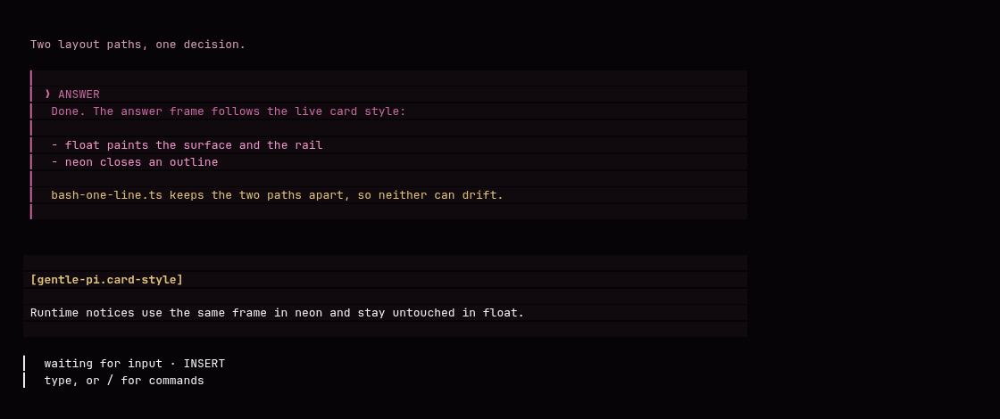

# gs-ui-better

Personal [Gentle Shell](https://github.com/Gentleman-Programming/gentle-shell) extensions: a better looking transcript — framed answers, framed runtime notices, a float prompt inside fullscreen, and the Gentleman's greeting.



*Demo image rendered from the real components with invented text — no session data.*

## What each file does

| File | What it does |
| --- | --- |
| `extensions/bash-one-line.ts` | The core. Compact one-row bash cards, the pink-mustache user message card, a `❯ ANSWER` frame around **only the final answer** of each reply (`Thinking` stays outside), and a closed frame for runtime notices in neon. In float it uses the surface + rail idiom, in neon a closed outline. It also makes the prompt use the float layout inside `tuiMode: "fullscreen"` (neon keeps the panel untouched). |
| `extensions/gentleman-greeting.ts` | Greeting and farewell as a transcript entry with the caballerito and the abuelita as inline PNGs. 20 opening and 20 closing phrases, chosen at random. |
| `extensions/herdr-agent-state.ts` | **Only for [Herdr](https://github.com/gentleman-programming/herdr)** users: reports the agent state to Herdr. If you do not use Herdr, do not install it. |
| `assets/gentleman-greeting/` | The 4 character PNGs and `frases.json` the greeting reads. |

## Requirements

- Gentle Shell with `gentle-pi` installed (tested on **4.7.0** with Pi **1.5.2**).
- Nothing else. No npm, no extra binary.

## Install

**Linux, macOS, Omarchy**

```bash
git clone https://github.com/efolchmontiel/gs-ui-better.git
cd gs-ui-better
./install.sh            # add --dry-run to see what it would do
```

**Windows** (PowerShell)

```powershell
git clone https://github.com/efolchmontiel/gs-ui-better.git
cd gs-ui-better
./install.ps1           # add -DryRun to see what it would do
```

Both scripts detect the Pi agent home (`GENTLE_PI_AGENT_HOME`, then `PI_CODING_AGENT_DIR`, then `~/.gentle-shell/agent`, then `~/.pi/agent`), back up any file they replace as `<file>.bak-<timestamp>`, copy the assets, and substitute the one import that must point at the installed `gentle-pi`. If `lib/shell-card.ts` cannot be found, `bash-one-line.ts` is skipped and Pi keeps its native cards; point `GS_UI_BETTER_SHELL_CARD` at the file and rerun.

Restart Gentle Shell (or `/reload`) afterwards.

## Your own characters

The greeting reads whatever you leave in `<agent home>/assets/gentleman-greeting/`. The sizes the layout was built for:

| Asset | Size |
| --- | --- |
| `inicio-caballerito.png` | 254 × 244 |
| `inicio-abuelita.png` | 254 × 200 |
| `cierre-caballerito.png` | 254 × 201 |
| `cierre-abuelita.png` | 254 × 186 |

Keep the width at **254 px** and trim the transparent border (`-trim`); the band centers itself on the text width, so a much wider image pushes the fallback to emojis.

## Uninstall

Delete the files from `<agent home>/extensions/` (and `assets/gentleman-greeting/` if you want the images gone) and restart. Or restore the `.bak-<timestamp>` copies the installer left.

## Compatibility

These extensions patch internal components of Pi and gentle-pi, so a Gentle Shell upgrade can break them until they are updated. `bash-one-line.ts` reads the live card style and never caches a style, and it falls back to the native rendering when a piece is missing, but it is still internal API.

## Contributing

Issues and pull requests are welcome. `main` is protected: it only moves through a reviewed pull request, never a direct push.

## License

MIT.
